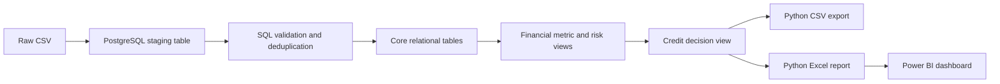
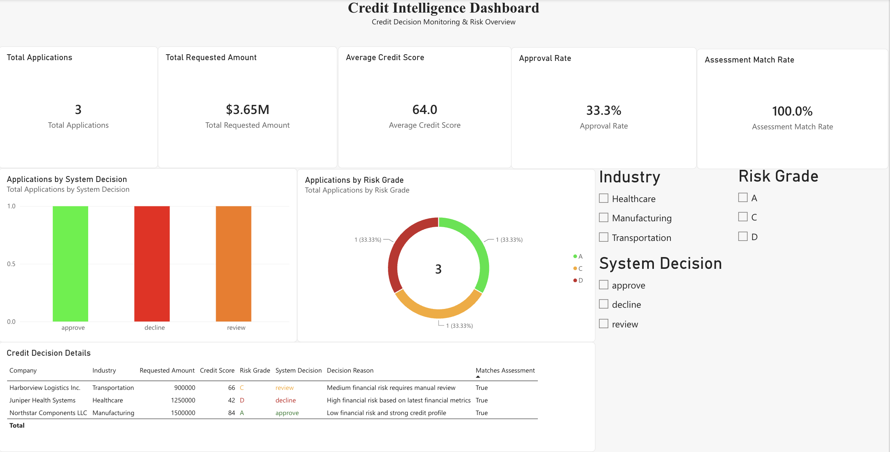

# Credit Intelligence Platform

An end-to-end SQL, Python, Excel, and Power BI portfolio project that converts raw borrower financial data into explainable credit-risk assessments and lending recommendations.

## Business objective

Credit analysts need to combine financial performance, liquidity, leverage, credit profile, and loan-request information before recommending whether an application should be approved, reviewed, or declined. This project creates a reproducible workflow for that process and keeps the final recommendation traceable to the underlying metrics.

## What the platform delivers

- Loads intentionally imperfect CSV data through a permissive staging layer.
- Detects missing values, invalid types, duplicates, and unmatched company IDs.
- Loads only validated, deduplicated records into the core PostgreSQL model.
- Calculates growth, profitability, cash-flow, and leverage indicators.
- Assigns company-level financial risk and application-level risk grades.
- Produces explainable `approve`, `review`, or `decline` recommendations.
- Exports reusable CSV and formatted Excel reports with Python.
- Presents portfolio KPIs and interactive decision analysis in Power BI.

## Architecture



The database performs the core transformations and decision calculations. Python orchestrates database access and creates portable reporting artifacts. Excel and Power BI present the results to business users.

## Technology

- PostgreSQL 16
- Python 3.12
- SQLAlchemy, Psycopg, XlsxWriter, and OpenPyXL
- Pytest and Ruff
- Microsoft Excel and Power BI Service

## Data model and decision flow

The core schema stores companies, yearly financial statements, credit assessments, and loan applications. The analytical layer then:

1. Calculates company-year financial ratios.
2. Uses window functions to identify trends and the latest available year.
3. Classifies the latest company financial risk.
4. Joins the latest risk profile to each loan application.
5. Calculates a system recommendation and human-readable decision reason.
6. Compares the calculated recommendation with the stored assessment result.

The sample portfolio intentionally includes one application in each decision category:

| Decision | Interpretation |
| --- | --- |
| `approve` | Strong credit profile and low financial risk |
| `review` | Mixed indicators requiring analyst judgment |
| `decline` | High financial risk based on the latest metrics |

## Verified results

- 3 credit applications
- $3.65 million in requested exposure
- 64.0 average credit score
- 1 approval, 1 manual review, and 1 decline
- 1 risk grade A, 1 grade C, and 1 grade D
- 100% agreement between system recommendations and stored assessments

These are demonstration results from synthetic portfolio data, not a production credit model or real lending recommendation.

## Dashboard



The Power BI report includes:

- KPI cards for total applications, requested amount, average credit score, approval rate, and assessment match rate
- Applications by system decision and by risk grade
- Slicers for industry, risk grade, and system decision
- A decision-detail table with conditional risk coloring and explanations

The live report is account-bound in Power BI Service. Its reproducible source workbook and verified dashboard specification are included in the repository. See [`docs/day8-power-bi.md`](docs/day8-power-bi.md).

## Repository structure

```text
data/
  raw/                         Sample inbound financial data
  processed/                   Generated credit-risk CSV
docs/                          Dashboard and portfolio documentation
outputs/day7-credit-report/    Generated Excel decision report
scripts/                       Database, ETL, and report-generation scripts
sql/                           Schema, validation, analytics, views, and decisions
src/credit_intelligence/       Reusable Python database package
tests/                         Automated tests
```

Key files:

- `sql/schema.sql`: normalized tables, constraints, and indexes
- `sql/day3_load_clean_data.sql`: validated and deduplicated staging load
- `sql/day4_financial_metrics_view.sql`: reusable financial calculations
- `sql/day4_latest_credit_risk_view.sql`: latest company risk classification
- `sql/day6_credit_decision_view.sql`: explainable lending decision engine
- `scripts/generate_credit_report.py`: CSV export
- `scripts/generate_excel_report.py`: formatted Excel report
- `outputs/day7-credit-report/credit_intelligence_report.xlsx`: final workbook

## Local setup

Requirements: Python 3.12, PostgreSQL 16, and a local PostgreSQL role and database.

```bash
python3.12 -m venv .venv
source .venv/bin/activate
python -m pip install -e '.[dev]'
cp .env.example .env
```

Update `.env` with the local database connection. The real `.env` file is ignored by Git.

Initialize the database and sample data:

```bash
python scripts/init_database.py
/opt/homebrew/opt/postgresql@16/bin/psql -U credit_app -d credit_intelligence -f sql/seed.sql
```

Run the staged CSV pipeline:

```bash
/opt/homebrew/opt/postgresql@16/bin/psql -U credit_app -d credit_intelligence -f sql/day3_staging_schema.sql
python scripts/import_financials.py
/opt/homebrew/opt/postgresql@16/bin/psql -U credit_app -d credit_intelligence -f sql/day3_load_clean_data.sql
```

Create the analytical views and reports:

```bash
/opt/homebrew/opt/postgresql@16/bin/psql -U credit_app -d credit_intelligence -f sql/day4_financial_metrics_view.sql
/opt/homebrew/opt/postgresql@16/bin/psql -U credit_app -d credit_intelligence -f sql/day4_latest_credit_risk_view.sql
/opt/homebrew/opt/postgresql@16/bin/psql -U credit_app -d credit_intelligence -f sql/day6_credit_decision_view.sql
python scripts/generate_credit_report.py
python scripts/generate_excel_report.py
```

## Quality checks

```bash
python scripts/check_database.py
pytest -q
ruff check .
```

Current verification: **6 tests passed** and **Ruff passed**.

## Portfolio talking points

- Built a staged SQL ETL workflow that validates and reconciles imperfect financial data before loading it into normalized PostgreSQL tables.
- Created reusable SQL views and an explainable decision engine using joins, CTEs, window functions, conditional logic, and financial ratios.
- Automated CSV and formatted Excel reporting with Python and designed an interactive Power BI dashboard for credit portfolio monitoring.

## Limitations and next steps

- The repository uses a small synthetic dataset for demonstration.
- Decision thresholds are transparent business rules, not a statistically trained probability-of-default model.
- The Power BI report remains in the owner's Power BI Service workspace.
- Future work could add historical performance outcomes, model monitoring, configurable thresholds, and a larger multi-period portfolio.
